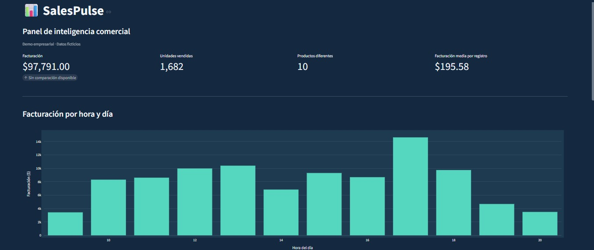
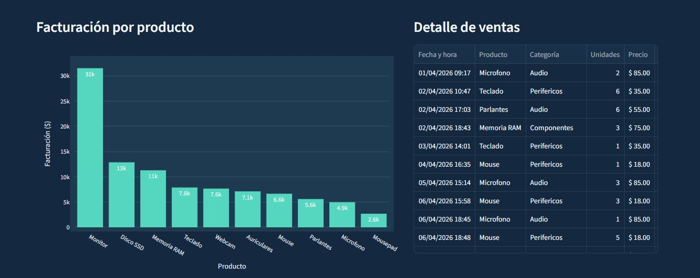
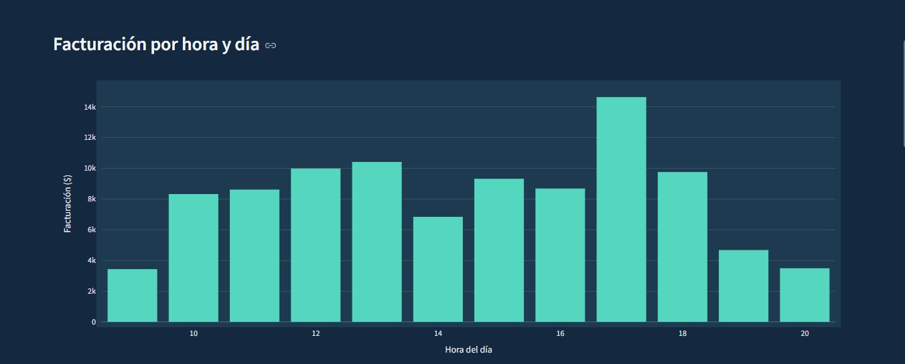
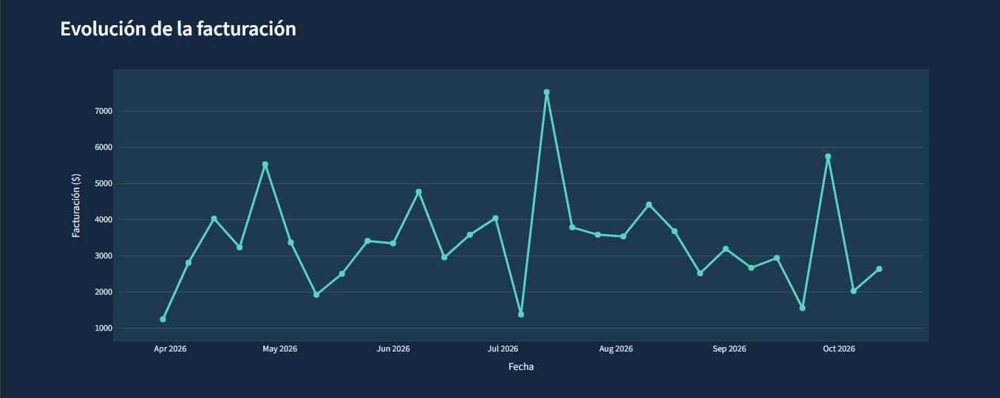

SalesPulse — Sales Analytics Dashboard

SalesPulse is an interactive sales analytics dashboard built with Python. It transforms sales data into visual insights, helping users explore revenue trends and product performance.

Features

- Sales KPIs: Key metrics for monitoring sales performance.
- Product Revenue Analysis: Compare revenue across products.
- Hourly Sales Analysis: Explore revenue by hour of the day.
- Weekly Revenue Trends: Track how revenue evolves over time.
- Interactive Data Exploration: Analyze sales data through a Streamlit dashboard.
- CSV Data Processing: Load and analyze sales records using Pandas.
- Data Visualization: Interactive charts powered by Plotly.

Tech Stack

- Python — Application logic and data processing.
- Pandas — Data manipulation and analysis.
- Streamlit — Interactive web dashboard.
- Plotly — Interactive charts and visualizations.

Project Structure

salespulse/
├── data/
│   ├── ventas_original.csv
│   └── ventas.csv
├── src/
│   ├── generar_ventas.py
│   ├── leer_ventas.py
│   ├── analisis_ventas.py
│   ├── dashboard.py
│   └── dashboard_backup.py
├── tests/
├── .streamlit/
├── .gitignore
└── requirements.txt

Getting Started

1. Clone the repository

git clone https://github.com/Uriel-Ortiz/SalesPulse.git
cd SalesPulse

2. Create a virtual environment

python -m venv .venv
source .venv/bin/activate

3. Install dependencies

pip install -r requirements.txt

4. Run the dashboard

streamlit run src/dashboard.py

Open the local URL provided by Streamlit in your browser.

Project Goals

SalesPulse demonstrates practical skills in data analysis, data processing, Python development, and interactive dashboard design.

Author

Uriel Ortiz

GitHub: "Uriel-Ortiz" (https://github.com/Uriel-Ortiz)

---

Built with Python, Pandas, Streamlit, and Plotly.

## Live Demo

Try the interactive dashboard online:

[Launch SalesPulse Dashboard](https://salespulse-uriel-ortiz.streamlit.app/)

## Dashboard Screenshots

### Dashboard Overview

### Revenue by Product

### Revenue by Hour

### Weekly Revenue

